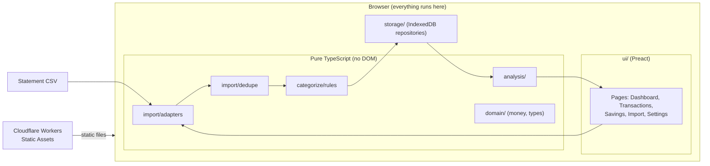

# Architecture (v1)



| Concern | How | Decision |
|---|---|---|
| Where the data lives | Only in the browser. The host serves static files; there is no API | [ADR 001](docs/adr/001-static-app-without-backend.md) |
| UI and build | Preact + Vite + TypeScript `strict`; Vitest for tests | [ADR 002](docs/adr/002-preact-vite-typescript-strict.md) |
| Storage | IndexedDB through `idb`: stores `transactions`, `imports`, `rules`, `categories`, `settings`, `dismissed`, with versioned migrations and JSON backup | [ADR 003](docs/adr/003-indexeddb-for-storage.md) |
| Hosting and deploy | Cloudflare Workers Static Assets with SPA fallback; deploy on merge, preview URL per PR (alternative: GitHub Pages) | [ADR 004](docs/adr/004-cloudflare-workers-static-assets-hosting.md) |
| Money | Integer cents everywhere; a pt-BR parser and formatter at the edges | [ADR 005](docs/adr/005-money-in-integer-cents.md) |
| Re-imports | Fingerprint (`date + merchant + amount + installment`) plus occurrence count; near-matches go to review | [ADR 006](docs/adr/006-dedupe-by-fingerprint-and-occurrence-count.md) |
| Categorization | Editable `contains` / `regex` rules by priority; a correction becomes a rule. No AI | [ADR 007](docs/adr/007-editable-rules-for-categorization-without-ai.md) |
| Bank formats | One `ImportAdapter` per format, chosen by `detect()`; v1 ships `nubank-card-csv` | [Spec §3](docs/spec/v1.md#3-import) |
| Privacy in the repo | `.gitignore` blocks statements; CI guard fails a PR that adds one outside `test/fixtures/` | [SECURITY.md](SECURITY.md) |

**Dependency rule.** `domain`, `import`, `categorize` and `analysis` are pure functions over plain data: no DOM, no IndexedDB, no Preact. `storage` persists their output; `ui` wires them together. This keeps the core testable without a browser and lets T04–T12 run in parallel with the UI tasks.

**Limits of this design.** Data is per browser and per device: no sync between phone and laptop except a manual backup file. Browsers can evict IndexedDB under storage pressure (the app asks for persistent storage, but it is not guaranteed), so backups matter. Categorization is only as good as the rules; unknown merchants stay "Uncategorized" until the user fixes one.

## Repository

```
src/
  domain/        types and pure rules: money, transaction, category
  import/        adapters/ (nubank-card-csv), dedupe
  categorize/    rules engine, category tree
  analysis/      totals, 50/30/20, insights
  storage/       IndexedDB repositories, migrations, backup
  ui/            pages/, components/, theme/
test/
  fixtures/      FICTITIOUS statements only
docs/            PRD, spec, ADRs, plan
.claude/agents/  developer, test-writer, code-reviewer
```
