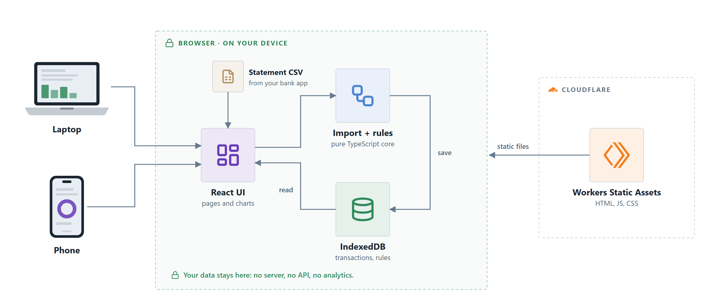
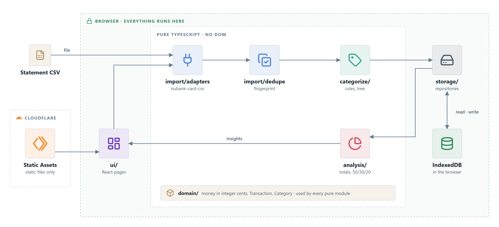
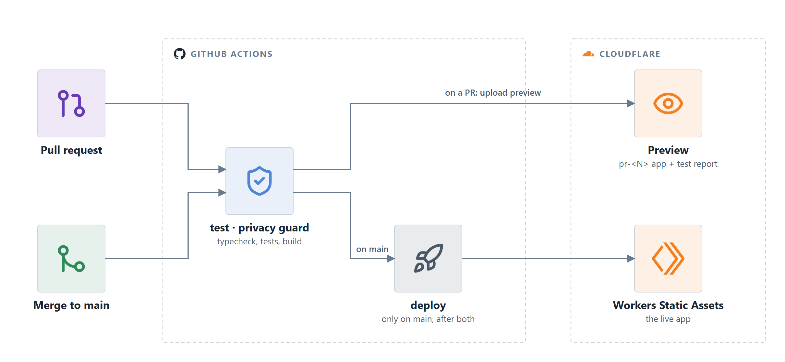

# Architecture (v1)

Build order ([plan](docs/plan.md)): foundation and domain (done) → categorization → analysis → **encrypted sync** → **assistant** (Claude Code commands) → **approved prototype** → screens in React → PWA and quality → demo v1.

<p align="center"></p>

## Module map

<p align="center"></p>

## Decisions

| Concern | How | Decision |
|---|---|---|
| Where the data lives | One instance per person, one owner. IndexedDB in the browser, synced end-to-end encrypted to the owner's own Worker + D1 behind Cloudflare Access (owner's e-mail only), with a recovery key; visitors use local mode. Sync comes before the UI (Phase 4). Supersedes ADR 001 | [ADR 011](docs/adr/011-self-hosted-instances-with-mandatory-e2e-sync.md) |
| UI and build | React + Vite + TypeScript `strict`; Vitest for tests | [ADR 010](docs/adr/010-react-replaces-preact.md), [ADR 002](docs/adr/002-preact-vite-typescript-strict.md) |
| Storage | IndexedDB through `idb`: stores `transactions`, `imports`, `rules`, `categories`, `settings`, `dismissed` (plus `limits` and `plans` later), with versioned migrations; JSON export optional | [ADR 003](docs/adr/003-indexeddb-for-storage.md) |
| Hosting and deploy | Cloudflare Workers Static Assets with SPA fallback; deploy on merge, preview URL per PR (alternative: GitHub Pages) | [ADR 004](docs/adr/004-cloudflare-workers-static-assets-hosting.md) |
| Money | Integer cents everywhere; a pt-BR parser and formatter at the edges | [ADR 005](docs/adr/005-money-in-integer-cents.md) |
| Re-imports | Fingerprint (`date + merchant + amount + installment`) plus occurrence count; near-matches go to review | [ADR 006](docs/adr/006-dedupe-by-fingerprint-and-occurrence-count.md) |
| Durability and sync | Random ids, monotonic `updatedAt` + `updatedBy`, tombstones; last-write-wins; an account epoch for delete all and restore | [ADR 008](docs/adr/008-data-durability-local-first-sync-ready.md), [ADR 009](docs/adr/009-sync-clock-and-record-identity.md), [ADR 011](docs/adr/011-self-hosted-instances-with-mandatory-e2e-sync.md) |
| Categorization | Editable category tree and `contains` / `regex` rules by priority; a correction becomes a rule and asks before touching past rows. No AI in the app | [ADR 007](docs/adr/007-editable-rules-for-categorization-without-ai.md) |
| Budget | Periods by statement (default) or calendar month; 50/30/20 with editable percentages; a limit per category; warning at 80%, over at 100% | [Spec §6](docs/spec/v1.md#6-analysis) |
| Assistant | Claude Code commands outside the app: `/organizar` writes rules, limits and a monthly plan to the cloud as encrypted records; `/investir` compares options. No AI API | [ADR 012](docs/adr/012-assistant-as-claude-code-commands.md) |
| Bank formats | One `ImportAdapter` per format, chosen by `detect()`; v1 ships `nubank-card-csv` | [Spec §3](docs/spec/v1.md#3-import) |
| Privacy in the repo | `.gitignore` blocks statements; CI guard fails a PR that adds one outside `test/fixtures/` | [SECURITY.md](SECURITY.md) |

**Dependency rule.** `domain`, `import`, `categorize` and `analysis` are pure functions over plain data: no DOM, no IndexedDB, no React. `storage` persists their output, `sync` (Phase 4) moves it encrypted to the owner's backend, and `ui` wires them together. This keeps the core testable without a browser, and lets the assistant commands reuse it.

**Limits of this design.** Until the owner turns on the cloud, data is per browser and per device, and browsers can evict IndexedDB under storage pressure (the app asks for persistent storage, but it is not guaranteed). With the cloud on, losing both the passphrase and the recovery key loses the cloud copy. Categorization is only as good as the rules; unknown merchants stay "Uncategorized" until the user fixes one.

## CI and deploy

<p align="center"></p>

See [ADR 004](docs/adr/004-cloudflare-workers-static-assets-hosting.md) and [docs/setup.md](docs/setup.md).

## Diagrams

The images are drawn by [`docs/architecture/draw.py`](docs/architecture/draw.py), which writes each as SVG and renders it to PNG at 2x with headless Chrome or Edge. It needs only Python 3.10+ and one of those browsers (set `CHROME=/path/to/browser` if it is not found). After changing it, regenerate and commit the SVG and PNG files:

```sh
python docs/architecture/draw.py             # SVG + PNG
python docs/architecture/draw.py --svg-only  # SVG only, no browser needed
```

The style and the approach (a Python generator, committed SVG and PNG) come from [YudiG12/second-brain-mcp](https://github.com/YudiG12/second-brain-mcp) (MIT). Line icons are [Lucide](https://lucide.dev) (ISC); the Cloudflare, Workers and GitHub marks in `brands.json` are [Simple Icons](https://simpleicons.org) (CC0). The diagrams contain no real data.

## Repository

```
src/
  domain/        types and pure rules: money, transaction, category
  import/        adapters/ (nubank-card-csv), dedupe
  categorize/    rules engine, category tree
  analysis/      totals, 50/30/20, insights
  storage/       IndexedDB repositories, migrations, backup
  sync/          crypto and sync engine (Phase 4)
  ui/            pages/, components/, theme/
test/
  fixtures/      FICTITIOUS statements only
docs/            PRD, spec, ADRs, plan, architecture diagrams (draw.py)
.claude/agents/  developer, test-writer, code-reviewer
.claude/commands/ /organizar, /investir (Phase 5)
```
