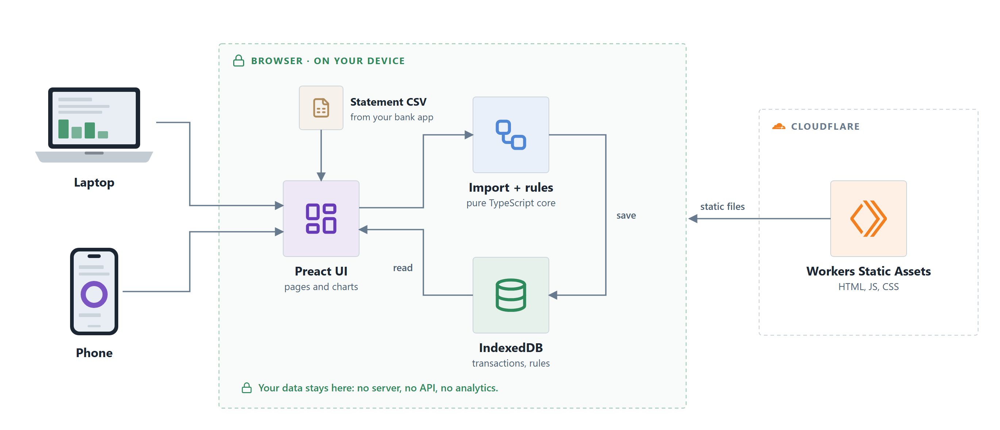

<p align="center"><a href="https://github.com/kauegalons/card-insights/actions/workflows/ci.yml"></a>    <a href="LICENSE"></a></p>

# card-insights

**A private spending dashboard for your credit card statement.** Drop the CSV your bank exports, and the app categorizes every purchase, shows where the money went, compares it with a 50/30/20 budget and points out where you could save. Everything runs in your browser. Each person runs their own instance on their own Cloudflare account, and the copy that syncs your phone and laptop is encrypted in the browser before it leaves: only you can read it.

<p align="center"></p>

v1 reads the **Nubank credit card CSV** (`date,title,amount`). Other banks plug in as import adapters.

> **Status:** Phases 0 and 1 are done (money, import, dedupe, sync-ready storage); next is categorization. The plan was revised on 2026-11-25: own instance, encrypted sync before the screens, React, an assistant as Claude Code commands. The design is in [PRD v1](docs/prd/v1.md) and [spec v1](docs/spec/v1.md); the build plan, one PR per task, is in [docs/plan.md](docs/plan.md).

## How to use

1. In the Nubank app, export the card statement as CSV.
2. Open card-insights and drop the file on **Import**. Re-importing the same statement, or a partial one before it closes, adds only what is new ([ADR 006](docs/adr/006-dedupe-by-fingerprint-and-occurrence-count.md)).
3. Fix any category that looks wrong; the app turns the fix into a rule for that merchant ([ADR 007](docs/adr/007-editable-rules-for-categorization-without-ai.md)).
4. Read the **Dashboard** and **Savings** pages. Set your monthly income in **Settings** to see the 50/30/20 split.

No CSV at hand? Use **See demo**: it loads fictitious data and never mixes it with yours.

Without the cloud, your data lives only in this browser. With the cloud on (your own instance, your login), it syncs end-to-end encrypted between your devices; exporting a JSON backup from **Settings** stays available, but is optional.

## Run your own instance

card-insights is self-hosted: one instance per person, on your own Cloudflare account (the free plan is enough), and only you log in to yours ([ADR 011](docs/adr/011-self-hosted-instances-with-mandatory-e2e-sync.md)). Anyone else who opens it gets the app in local mode.

1. **Fork** the repo and clone your fork.
2. **Cloudflare API token and account ID** as GitHub secrets; every merge to `main` deploys.
3. **D1 database** for the encrypted copy *(arrives in Phase 4)*.
4. **Cloudflare Access with your e-mail** in front of the API and the PR previews, so only you get in.
5. **Turn on the cloud** in Settings, set a passphrase and keep the **recovery key** it shows once: it is the only way back if you forget the passphrase *(Phase 4 and Settings, Phase 7)*.
6. **Claude Code** (a Claude Pro plan is enough) in your clone, for the assistant: `/organizar` writes a monthly plan and limits per category to your cloud, `/investir` compares where to put what you save. The app itself calls no AI ([ADR 012](docs/adr/012-assistant-as-claude-code-commands.md)) *(Phase 5)*.

Step by step, with the parts that exist today: [docs/setup.md](docs/setup.md).

```sh
git clone https://github.com/<you>/card-insights && cd card-insights
npm ci && npm run build      # the app is in dist/
```

## Links

- [Architecture](ARCHITECTURE.md)
- [Decisions (ADRs)](docs/adr/README.md) · [Spec v1](docs/spec/v1.md) · [PRD v1](docs/prd/v1.md) · [Plan](docs/plan.md)
- [CHANGELOG](CHANGELOG.md) · [Contributing](CONTRIBUTING.md) · [Security and privacy](SECURITY.md) · [MIT license](LICENSE)
