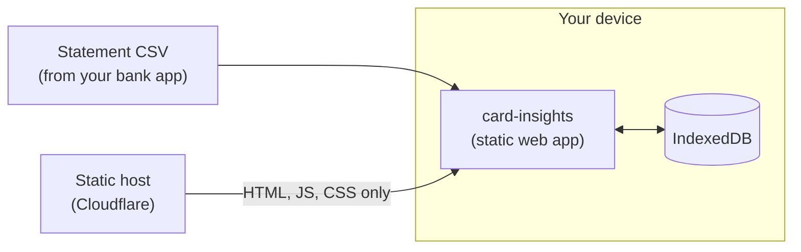

<p align="center"><a href="https://github.com/kauegalons/card-insights/actions/workflows/ci.yml"></a>    <a href="LICENSE"></a></p>

# card-insights

**A private spending dashboard for your credit card statement.** Drop the CSV your bank exports, and the app categorizes every purchase, shows where the money went, compares it with a 50/30/20 budget and points out where you could save. Everything runs in your browser: your statements never leave your device.

v1 reads the **Nubank credit card CSV** (`date,title,amount`). Other banks plug in as import adapters.

> **Status:** planning. The design is in [PRD v1](docs/prd/v1.md) and [spec v1](docs/spec/v1.md); the build plan, one PR per task, is in [docs/plan.md](docs/plan.md).



## How to use

1. In the Nubank app, export the card statement as CSV.
2. Open card-insights and drop the file on **Import**. Re-importing the same statement, or a partial one before it closes, adds only what is new ([ADR 006](docs/adr/006-dedupe-by-fingerprint-and-occurrence-count.md)).
3. Fix any category that looks wrong; the app turns the fix into a rule for that merchant ([ADR 007](docs/adr/007-editable-rules-for-categorization-without-ai.md)).
4. Read the **Dashboard** and **Savings** pages. Set your monthly income in **Settings** to see the 50/30/20 split.

No CSV at hand? Use **See demo**: it loads fictitious data and never mixes it with yours.

Your data lives only in this browser. Export a JSON backup from **Settings** before clearing site data or switching devices.

## Deploy your own

The app is static files, so any static host works. The repo deploys to Cloudflare Workers Static Assets on every merge to `main` ([ADR 004](docs/adr/004-cloudflare-workers-static-assets-hosting.md)).

```sh
git clone https://github.com/kauegalons/card-insights && cd card-insights
npm ci && npm run build      # the app is in dist/
```

Step-by-step for your own Cloudflare account (fork, API token, secrets, previews): [docs/setup.md](docs/setup.md).

## Links

- [Architecture](ARCHITECTURE.md)
- [Decisions (ADRs)](docs/adr/README.md) · [Spec v1](docs/spec/v1.md) · [PRD v1](docs/prd/v1.md) · [Plan](docs/plan.md)
- [CHANGELOG](CHANGELOG.md) · [Contributing](CONTRIBUTING.md) · [Security and privacy](SECURITY.md) · [MIT license](LICENSE)
