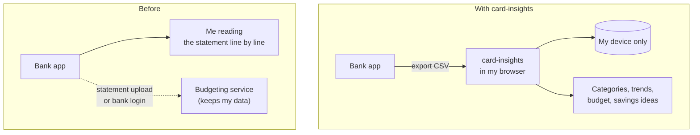
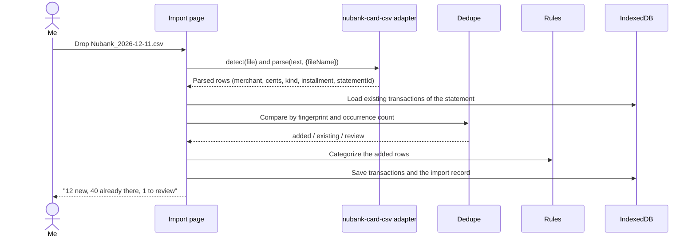

# PRD: card-insights v1

| | |
|---|---|
| **Status** | Draft |
| **Author** | Kaue Galon |
| **Date** | 2026-11-24 |
| **Spec** | [Spec v1](../spec/v1.md) |
| **Plan** | [docs/plan.md](../plan.md) |

## Problem

My credit card statement tells me what I spent, line by line, but not **where the money goes** or **what I could cut**. The bank app shows a rough breakdown per statement and nothing more. Four gaps:

1. **No categories I can trust or change.** Merchant names come with acquirer prefixes and installment suffixes, so the same store shows up under several names, and I can't fix a wrong category.
2. **No view across months.** I can't see whether a category is growing, or how much of next months' budget is already taken by installments.
3. **No budget to compare against.** I have no simple reference such as 50/30/20 against my income.
4. **The tools that do this want my data.** Budgeting apps ask for bank logins or upload statements to their servers. I don't want my spending on someone else's database.

## Context: before and after

## Users

One user to start: me, on the phone and on the laptop, with a Nubank credit card. Anyone else can open the public deployment or deploy their own; their data stays on their device too.

## Goals

| ID | Goal | Tasks |
|---|---|---|
| G1 | Import a Nubank card statement CSV entirely in the browser, with nothing sent to a server, and amounts exact to the cent. | T04, T05, T21 |
| G2 | Re-import safely: the same statement twice, or a partial one followed by the closed one, adds only new rows, and two legitimate identical purchases both stay. | T06, T21 |
| G3 | Every transaction gets a category from rules I can edit, and fixing one category teaches the app that merchant; a wrong or cancelled transaction can be deleted. Categories themselves are editable. | T08, T09, T22, T25 |
| G4 | See where the money goes: totals by category and subcategory, per statement and per month, change from the last statement, top merchants and installments already committed for the coming months. | T10, T23 |
| G5 | Compare spending with a 50/30/20 budget (percentages editable) against my monthly income, and with a monthly limit per category. | T11, T23, T24 |
| G6 | Get savings suggestions that explain why and how much, without AI. | T12, T24 |
| G7 | Own my data: export a full backup, restore it and delete everything. | T07, T25 |
| G8 | Use it on the phone: installable, works offline, accessible (keyboard, contrast AA, tables behind every chart). | T20, T27, T28 |
| G9 | Try it without a CSV (demo data) and deploy your own copy for free. | T26, T03 |
| G10 | Be reminded to import when the statement closes. | T29 |
| G11 | Engineering: tests before code, CI on every PR, a guard that keeps real statements out of the repo, deploy on merge, decisions recorded as ADRs. | T00, T01, T02, T03, T28 |

| G12 | Phone and laptop show the same data: end-to-end encrypted sync to my own Cloudflare account, with a recovery key ([ADR 011](../adr/011-self-hosted-instances-with-mandatory-e2e-sync.md)). | T13, T14, T15, T16, T25 |
| G13 | Get a monthly plan (savings goal, where to cut, projection, limits per category) and an investment comparison from Claude Code commands that work on my synced data, while the app itself stays AI-free ([ADR 012](../adr/012-assistant-as-claude-code-commands.md)). | T17, T18, T24 |

## Non-goals for v1

- **Accounts or a shared server.** Each person runs their own instance with one owner; the only backend is the owner's own Worker and D1, and it sees only ciphertext ([ADR 011](../adr/011-self-hosted-instances-with-mandatory-e2e-sync.md)).
- **Bank connections** (Open Finance, scraping, logins).
- **AI inside the app.** Categorization and insights are rules ([ADR 007](../adr/007-editable-rules-for-categorization-without-ai.md)); the assistant is Claude Code commands outside the app ([ADR 012](../adr/012-assistant-as-claude-code-commands.md)).
- **Other banks and formats.** The adapter interface allows them; v1 ships only the Nubank card CSV. The checking account PDF is listed under "After v1" in the plan.
- **Investment tracking, net worth or bill payment.** `/investir` compares options and suggests a split; it keeps no portfolio.
- **More than one card or person per installation.**

## User stories

1. When my statement closes, I export the CSV, drop it in the app, and see "X new, Y already there, Z to review".
2. I see that groceries went up 30% against my three-month average, and the app tells me how much I'd save by returning to the average.
3. I correct "Uncategorized" to Transport → Fuel for a gas station, and next month that station comes in already categorized.
4. I enter my income and see that "wants" are at 41% against a 30% target.
5. Before switching phones, I export a backup and restore it on the new one.

### Story 1, step by step

## Requirements

### Functional

| ID | Requirement |
|---|---|
| FR1 | Detect the Nubank card CSV by its exact header `date,title,amount`; reject other formats with a clear message. |
| FR2 | Parse pt-BR amounts (`"1.234,56"`, `"- 3.092,77"`) into integer cents; an invalid amount is an error that names the line. |
| FR3 | Extract the installment (`Parcela n/N`) and the merchant without the suffix; strip acquirer prefixes (`Mlp*`, `Wl *`, `Dl*`, `Htm*`, `Pg *` and similar). |
| FR4 | Classify each row: `payment` (statement payment, excluded from spending), `fee` (IOF, interest), `refund` (other negative amounts), `purchase`. |
| FR5 | Derive the statement id from the file name (`Nubank_YYYY-MM-DD.csv`) or, without it, from the latest date in the file. |
| FR6 | Dedupe by fingerprint and occurrence count; flag same date and amount with a different title for review ([ADR 006](../adr/006-dedupe-by-fingerprint-and-occurrence-count.md)). |
| FR7 | Categorize by rules in priority order over a two-level category tree; the first match wins; no match is "Uncategorized". |
| FR8 | A manual category change creates a merchant rule, optionally applied to the other transactions of that merchant. |
| FR8a | Delete a transaction (e.g. a cancelled purchase), with confirmation and undo; a deleted row that is still in the file is not added back on re-import. |
| FR9 | Totals by category, subcategory, statement and month; change against the previous statement; top merchants; future installments. Payments are excluded; refunds reduce their category. |
| FR10 | 50/30/20: map each category to needs, wants or savings (editable), with editable percentages, and compare with the income in settings. A monthly limit per category, editable. Warning at 80%, over at 100% (adjustable). |
| FR11 | Explainable insights: recurring subscriptions, categories above their three-month average, installment weight on income, IOF paid, savings if a category returns to average. |
| FR12 | Backup to JSON, restore from JSON, delete all data. |
| FR13 | Demo mode with fictitious data, kept apart from real data. |
| FR14 | A reminder to import after the configured statement closing day, with the date of the last import. |
| FR15 | Turn on the cloud: passphrase, a recovery key shown once, end-to-end encrypted sync with the owner's Worker and D1 behind Cloudflare Access; totals per statement (default) or calendar month. |
| FR16 | Rules, limits and a monthly plan written by `/organizar` arrive as synced records the owner can edit. |

### Non-functional

| ID | Requirement |
|---|---|
| NFR1 | **Privacy:** no request carries readable user data: only end-to-end encrypted records, to the owner's own Worker; no analytics or third-party scripts ([ADR 011](../adr/011-self-hosted-instances-with-mandatory-e2e-sync.md)). |
| NFR2 | **Correctness of money:** no floating-point arithmetic on amounts ([ADR 005](../adr/005-money-in-integer-cents.md)). |
| NFR3 | **Idempotent import:** importing the same file again changes nothing. |
| NFR4 | **Accessibility:** Lighthouse accessibility ≥ 95, full keyboard navigation, contrast AA, no serious axe violation in CI. |
| NFR5 | **Mobile first:** smooth on a mid-range phone with a year of transactions; installable and usable offline. |
| NFR6 | **Free to run:** fits Cloudflare's free tier (Workers, D1, Access) for one owner. |
| NFR7 | **Tested:** the pure domain code has unit tests for every acceptance criterion in the plan. |

## Success criteria

- Re-importing a statement adds zero rows; importing the partial and then the closed statement adds only the new rows.
- After a few corrections, at least 90% of a month's transactions are categorized automatically.
- Totals in the app match a hand-checked sum of the fixture.
- A visitor without a CSV understands the app through the demo.
- The repository contains no real statement data, and CI proves it.

## Related

- [Spec v1](../spec/v1.md) · [Architecture](../../ARCHITECTURE.md) · [Plan](../plan.md)
- ADRs [001](../adr/001-static-app-without-backend.md) · [002](../adr/002-preact-vite-typescript-strict.md) · [003](../adr/003-indexeddb-for-storage.md) · [004](../adr/004-cloudflare-workers-static-assets-hosting.md) · [005](../adr/005-money-in-integer-cents.md) · [006](../adr/006-dedupe-by-fingerprint-and-occurrence-count.md) · [007](../adr/007-editable-rules-for-categorization-without-ai.md) · [008](../adr/008-data-durability-local-first-sync-ready.md) · [009](../adr/009-sync-clock-and-record-identity.md) · [010](../adr/010-react-replaces-preact.md) · [011](../adr/011-self-hosted-instances-with-mandatory-e2e-sync.md) · [012](../adr/012-assistant-as-claude-code-commands.md)
