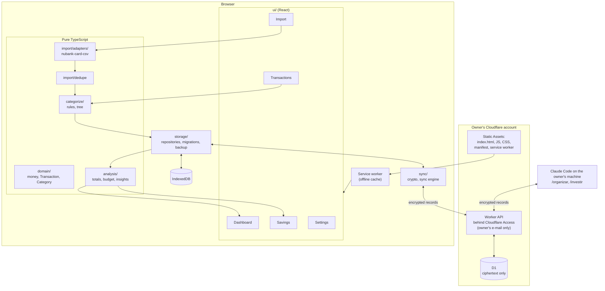
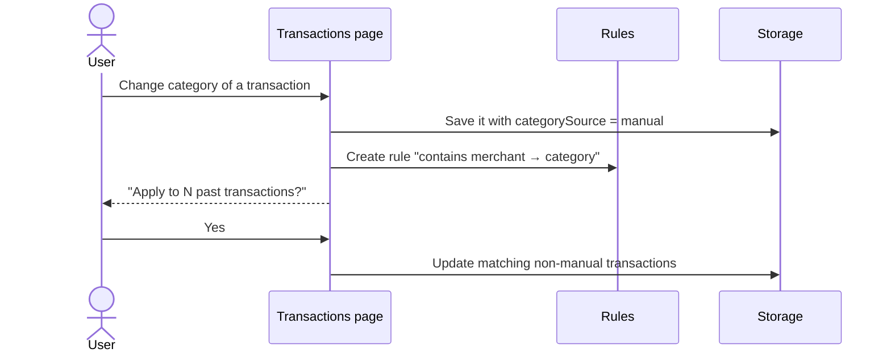

# Spec: card-insights v1

| | |
|---|---|
| **Status** | Draft |
| **Author** | Kaue Galon |
| **Date** | 2026-11-24 |
| **PRD** | [PRD v1](../prd/v1.md) |
| **Decisions** | [ADR 001](../adr/001-static-app-without-backend.md) to [ADR 012](../adr/012-assistant-as-claude-code-commands.md); the plan revision of 2026-11-25 added [ADR 010](../adr/010-react-replaces-preact.md) (React), [ADR 011](../adr/011-self-hosted-instances-with-mandatory-e2e-sync.md) (self-hosted instances, end-to-end encrypted sync) and [ADR 012](../adr/012-assistant-as-claude-code-commands.md) (assistant as Claude Code commands) |

All examples in this document are **fictitious**.

## 1. Architecture



| Component | Role |
|---|---|
| **domain/** | Types (`Transaction`, `Category`, `Rule`, `Settings`) and money helpers (`parseBrlAmount`, `formatBrl`). No I/O. |
| **import/adapters/** | One `ImportAdapter` per file format. Turns text into `ParsedRow[]`. |
| **import/dedupe** | Compares parsed rows with what is stored; returns what to add and what to review. |
| **categorize/** | Default category tree and the rules engine. |
| **analysis/** | Totals, 50/30/20 and insights, as pure functions over transactions. |
| **storage/** | The only module that touches IndexedDB. Repositories per store, schema migrations, backup and restore. |
| **sync/** | Phase 4. Encrypts records in the browser (AES-GCM, data key wrapped by the passphrase and by the recovery key), pushes and pulls them through the Worker API, resolves conflicts by last-write-wins ([ADR 009](../adr/009-sync-clock-and-record-identity.md), [ADR 011](../adr/011-self-hosted-instances-with-mandatory-e2e-sync.md)). The protocol is fixed by the T13 ADR. |
| **ui/** | Pages and components in React ([ADR 010](../adr/010-react-replaces-preact.md)). Calls the pure modules and storage; holds no business rules. |
| **Worker API + D1** | The owner's own backend, behind Cloudflare Access with a policy for the owner's e-mail only. Stores `id`, `updatedAt`, `updatedBy`, `deletedAt`, the account epoch and ciphertext; never reads the data. Visitors without the owner's login use the app in local mode. |
| **Assistant** | Claude Code commands outside the app (`/organizar`, `/investir`, [ADR 012](../adr/012-assistant-as-claude-code-commands.md)). `/organizar` reads and writes encrypted records through the same API. The app itself calls no AI API. |
| **Service worker** | Caches the app shell for offline use (T27). Never caches or sends user data. |

## 2. Data model

Money is integer cents (`number`, always an integer); dates are ISO `YYYY-MM-DD` strings with no time zone ([ADR 005](../adr/005-money-in-integer-cents.md)).

### Transaction

| Field | Type | Notes |
|---|---|---|
| `id` | `string` | Random UUID, assigned on import. |
| `date` | `string` | ISO date from the file. |
| `rawTitle` | `string` | The title exactly as in the file. |
| `merchant` | `string` | Normalized: acquirer prefix and installment suffix removed, spacing collapsed. |
| `amountCents` | `number` | Positive for purchases and fees, negative for refunds and payments. |
| `kind` | `'purchase' \| 'refund' \| 'payment' \| 'fee'` | See §3.3. |
| `installment` | `{ n: number; total: number }?` | From `Parcela n/N`. |
| `categoryId` | `string?` | Subcategory id; absent means "Uncategorized". |
| `categorySource` | `'rule' \| 'manual'?` | A manual choice is never overwritten by rules. |
| `statementId` | `string` | Closing date of the statement, `YYYY-MM-DD`. |
| `fingerprint` | `string` | See §4. |
| `importId` | `string` | The import that added it. |
| `status` | `'ok' \| 'review'` | `review` until the user resolves a possible duplicate. |
| `updatedAt` | `string` | ISO timestamp, set by the repository on every write, strictly increasing per device ([ADR 008](../adr/008-data-durability-local-first-sync-ready.md), [ADR 009](../adr/009-sync-clock-and-record-identity.md)). |
| `updatedBy` | `string` | `deviceId` of the device that wrote it; breaks `updatedAt` ties in last-write-wins (ADR 009). |
| `deletedAt` | `string?` | Tombstone: a delete sets it instead of removing the record; queries skip it. |

### Other stores

| Store | Key | Content |
|---|---|---|
| `imports` | `id` | `{ id, adapterId, fileName, statementId, importedAt, summary: { added, existing, review } }`. Never the file content. |
| `categories` | `id` | `{ id, name, parentId?, budgetGroup?: 'needs' \| 'wants' \| 'savings' }`. Two levels. Editable: the user creates, renames and deletes categories and subcategories, defaults included (§5). |
| `rules` | `id` | `{ id, match: 'contains' \| 'regex', pattern, categoryId, priority, origin: 'default' \| 'user' \| 'assistant' }`. `assistant` rules are written by `/organizar` (§6.1). |
| `limits` | `id` | `{ id, categoryId, amountCents, source: 'user' \| 'assistant' }`: a monthly spending limit for one category (T11). At most one live limit per category; editing one written by the assistant makes it `user`. |
| `plans` | `id` | `{ id, month: 'YYYY-MM', createdAt, savingsGoalCents, cuts: { categoryId, amountCents, why }[], projection: { month, savedCents }[], nextMonth: string[], source: 'assistant' }`: the monthly plan written by `/organizar` (T17, §6.1). The app shows the latest. |
| `settings` | `key` | `monthlyIncomeCents`, `statementClosingDay`, `budgetSplit` (`{ needs, wants, savings }`, whole percentages summing 100, default 50/30/20), `thresholds` (`{ warnPercent: 80, overPercent: 100, spikePercent: 30, spikeMinCents: 5000 }` by default), `demo`, `schemaVersion`, `deviceId` (random UUID, created once), `lastSyncAt?`, `lastStampAt` (last `updatedAt` stamped, ADR 009). `deviceId`, `lastStampAt` and `lastSyncAt` are device-local: never in a backup or the cloud, kept on restore (§7). `monthlyIncomeCents`, `statementClosingDay`, `budgetSplit` and `thresholds` become synced records in Phase 4 (the T13 ADR fixes their shape). Schema v1 also has `lastBackupAt?` and `backupFileHandle?` (automatic file backup, [ADR 008](../adr/008-data-durability-local-first-sync-ready.md)); [ADR 011](../adr/011-self-hosted-instances-with-mandatory-e2e-sync.md) drops that feature and a later migration (T16) removes them. |
| `dismissed` | `id` | `{ id, fingerprint, dismissedAt }`, one record per occurrence the user deleted, so re-import doesn't bring it back (§4). Indexed by `fingerprint`, which is never a key ([ADR 009](../adr/009-sync-clock-and-record-identity.md)). |

Every record in `imports`, `categories`, `rules`, `limits`, `plans` and `dismissed` also has `updatedAt`, `updatedBy` and `deletedAt?`, like `Transaction`, so sync (Phase 4) needs no change to their shape ([ADR 008](../adr/008-data-durability-local-first-sync-ready.md), [ADR 011](../adr/011-self-hosted-instances-with-mandatory-e2e-sync.md)).

## 3. Import

### 3.1 Adapter interface

```ts
interface ImportAdapter {
  id: string;                                   // 'nubank-card-csv'
  detect(file: { name: string; text: string }): boolean;
  parse(text: string, meta: { fileName: string; statementClosingDay?: number }): ParsedRow[];
}

interface ParsedRow {
  date: string;
  rawTitle: string;
  merchant: string;
  amountCents: number;
  kind: TransactionKind;
  installment?: { n: number; total: number };
  statementId: string;
  statementIdFrom: 'fileName' | 'closingDay' | 'latestDate'; // see §3.2
}
```

The Import page runs `detect` on every registered adapter and uses the first that matches. No match is a user-facing error: "Format not recognized".

### 3.2 Nubank card CSV

Header, exactly: `date,title,amount`. Amounts are pt-BR, quoted, with `.` for thousands and `,` for decimals; a negative amount has a space after the sign.

```csv
date,title,amount
2026-10-21,Padaria Exemplo,"18,50"
2026-10-14,Mlp*Loja Exemplo - Parcela 2/6,"149,90"
2026-10-06,Pagamento recebido,"- 1.234,56"
2026-10-03,IOF de compra internacional,"3,12"
```

| Rule | Example → result |
|---|---|
| Amount | `"1.234,56"` → `123456`; `"- 1.234,56"` → `-123456`; `"60,00"` → `6000`; `"12,3"` → error |
| Installment | `Loja Exemplo - Parcela 2/6` → merchant `Loja Exemplo`, `{ n: 2, total: 6 }` |
| Prefixes | `Mlp*`, `Wl *`, `Dl*`, `Htm*`, `Pg *` and `<x> I*Vmt*Cielo`-style acquirer markers are stripped |
| Statement id | `Nubank_2026-11-11.csv` → `2026-11-11` (`statementIdFrom: 'fileName'`), also with the copy suffix browsers add, `Nubank_2026-11-11 (1).csv`. Any other name → the first closing date on or after the latest `date` in the file, using `settings.statementClosingDay` (passed in `meta`; `'closingDay'`); without a closing day, the latest `date` itself (`'latestDate'`: provisional, see §4 step 5). The statement id is for grouping in the UI only: dedupe never depends on it (§4) |
| Merchant spacing | Runs of whitespace inside the merchant become one space: `Padaria   Exemplo` → `Padaria Exemplo`; `rawTitle` keeps them |
| Sign | Any whitespace after the sign is accepted, no-break space included: `"-\u00a060,00"` → `-6000` |

### 3.3 Kind

| Condition | Kind |
|---|---|
| Title is `Pagamento recebido` | `payment` (internal transfer: excluded from all spending totals) |
| Title starts with `IOF` or names interest (`Juros`) | `fee` |
| Negative amount, not a payment | `refund` |
| Anything else | `purchase` |

## 4. Dedupe

```
fingerprint = date | normalizedMerchant | amountCents | installment.n/total (or "-")
```

The file has no time and no row id, so two identical purchases on the same day are indistinguishable except by count ([ADR 006](../adr/006-dedupe-by-fingerprint-and-occurrence-count.md)).

1. Group incoming rows, and stored transactions whose `date` falls within the file's date range, by fingerprint. The scope is the date range, not the `statementId`: a partial export without the closing date in its name must still match the closed statement imported later.
2. For each fingerprint: `toAdd = max(0, countInFile − countStored − countDismissed)`. File has 3, store has 2 → add 1. `countDismissed` is the number of live `dismissed` records with that fingerprint: each row the user deleted (T22) is one, so it isn't added back.
3. An incoming row whose fingerprint is new but whose `date + amountCents` matches a stored transaction (same date range) with a different merchant is added with `status: 'review'` (likely the bank renamed it).
4. Return the rows to add (each with its `fingerprint` and `status`) and `ImportSummary { added, existing, review }`: disjoint counts that add up to the file's rows (`added` are new `ok` rows, `review` new `review` rows, `existing` rows skipped as stored or dismissed). Matching rows consume stored transactions first, then dismissed occurrences; the ids of the stored ones are returned as `matchedIds`.
5. **One statement after a partial import.** When the file's statement id is known (`statementIdFrom` is `fileName` or `closingDay`), matched stored rows with another `statementId` are returned in `moveToStatement`, and the import commit sets their `statementId` to the file's, in the same IndexedDB transaction. A file whose id is only its latest date (`latestDate`) moves nothing. So a partial export then the closed statement leave one statement, and a partial export after the closed one doesn't split it.

`normalizedMerchant` in the fingerprint is the row's `merchant` lowercased, without accents and with spacing collapsed. Fingerprints are stored, so **changing merchant normalization (or anything else in the fingerprint) requires a migration that recomputes the stored fingerprints**, in `transactions` and `dismissed`; otherwise re-imports duplicate rows ([ADR 009](../adr/009-sync-clock-and-record-identity.md)).

## 5. Categorization

Rules run in ascending `priority`, ties broken by `id` so every device picks the same rule; the first match wins and no match is Uncategorized (`categoryId` absent). Both kinds test the normalized merchant (lowercase, no accents, spacing collapsed, as in §4): `contains` normalizes its pattern the same way; `regex` is a JavaScript regex with the `i` flag whose pattern has its accents stripped. A rule is validated when it is created (`validateRule`): a blank pattern, a non-integer priority or a regex that doesn't compile fails there with a clear error (`Invalid regular expression "<pattern>": …`), never while categorizing. Transactions with `categorySource: 'manual'` are skipped.

**Default ids.** Default categories and default rules have **fixed UUIDs** shipped in the code (`00000000-0000-4000-8000-…` for categories, `…-8001-…` for rules, numbered by position), never derived from a name ([ADR 009](../adr/009-sync-clock-and-record-identity.md)). Every install seeds the same ids, so two devices seeding the defaults write the same records, and sync merges them instead of duplicating. Default rules start at priority 1000 and step by 10; user rules (T09) take lower numbers, so they run first.

Default tree (names shown in pt-BR in the UI):

| Category | Subcategories |
|---|---|
| Transport | Fuel, Ride apps, Parking and tolls, Public transport |
| Food | Groceries, Produce, Bakery, Delivery, Restaurant |
| Housing | Rent and condo fees, Power, water and gas, Maintenance and furniture |
| Health | Pharmacy, Appointments and tests |
| Education | Courses, Books |
| Subscriptions | Software/Cloud, Games, Streaming |
| Shopping | Electronics, Clothing and shoes |
| Home and services | Phone and internet, Consulting |
| Leisure and travel | Tickets, Lodging, Outings and events, Bars |
| Pets and personal care | Pet shop and vet, Beauty, Gym |
| Gifts and donations | Gifts, Donations |
| Fees | IOF, Interest, Annual fee |

**Editable tree (T08).** The user creates, renames and deletes categories and subcategories, defaults included. Deleting one asks where its transactions and rules go (another category or Uncategorized) and moves them in the same IndexedDB transaction, so nothing points to a deleted category. New categories get a random UUID. A name is trimmed, never blank, and unique among its siblings ignoring case and accents; a subcategory's parent must be top-level (two levels). Deleting a top-level category deletes its subcategories too. The target is a live **subcategory** outside the deletion, or Uncategorized: with a subcategory, transactions (manual ones stay manual) and rules move to it; with Uncategorized, transactions lose `categoryId` and `categorySource`, and the rules are deleted, since a rule always needs a category (`deleteCategory` in `src/categorize/edit.ts`).

**Learning (T09).** Changing a transaction's category creates a user rule `contains <merchant> → category` with a priority above all default rules, then **asks** whether to apply it to the N past transactions of that merchant (N excludes manual ones). Only a yes changes them.

## 6. Analysis

All functions take `Transaction[]` (plus settings) and return plain objects.

**Periods.** `Period = { kind: 'statement'; statementId: string } | { kind: 'month'; month: 'YYYY-MM' }`. The statement is the default; a calendar month groups by `date`. "Previous" means the previous statement or the previous month.

| Function | Output |
|---|---|
| `totalsByCategory(tx, period)` | Cents per category and subcategory; `payment` excluded; `refund` subtracts. |
| `compareWithPrevious(tx, period)` | Delta per category against the previous period, in cents and %. |
| `topMerchants(tx, period, n)` | Merchants by total spent. |
| `monthlyTrend(tx, months)` | Total spent per month, for the trend chart. |
| `futureInstallments(tx, fromStatement)` | Cents committed per future month: for a row at `n/total`, `total − n` more charges. |
| `budgetSplit(tx, period, settings)` | Share of income in needs, wants and savings against `settings.budgetSplit` (default 50/30/20), with a status per group. |
| `limitStatus(tx, period, limits, settings)` | Spent against the limit per category, with a status; categories without a limit are left out. |
| `insights(tx, settings)` | `{ id, title, why, amountCents }[]`, one per rule that fires (§PRD FR11). A category "went up" when it is more than `spikePercent` (30%) above its three-month average **and** at least `spikeMinCents` (R$ 50) above it. |

**Status.** For a budget group or a limit, `used = spent / target`: `ok` below `warnPercent` (80%), `warning` from `warnPercent` up to `overPercent` (100%), `over` above `overPercent`. Both thresholds live in `settings.thresholds` and are editable; `budgetSplit` percentages must be whole numbers summing to 100, or saving them fails with a clear error.

### 6.1 Records written by the assistant

`/organizar` ([ADR 012](../adr/012-assistant-as-claude-code-commands.md)) runs on the owner's machine, decrypts the cloud copy with the passphrase, runs the functions above and, after the owner confirms, writes **ordinary synced records**, encrypted, through the sync API: `rules` with `origin: 'assistant'`, `limits` with `source: 'assistant'` and one `plans` record for the month. They carry `id`, `updatedAt`, `updatedBy` (the assistant's own device id) and `deletedAt?` like any record, pass the same validation as a restore (§7), and reach the app on its next sync, where the owner can edit or delete them. `/investir` writes nothing.

## 7. Storage

- IndexedDB through `idb`, database `card-insights`, one object store per table in §2, with indexes on `transactions.statementId`, `transactions.fingerprint` and `transactions.date`, and on `updatedAt` in every synced store (serves `changedSince`).
- `schemaVersion` increases with each change; `upgrade` runs the migrations in order. An open tab closes its connection when another tab opens a newer version; a tab whose upgrade waits on one that doesn't is told (`onBlocked`), so the UI can ask the user to close it.
- **Repositories:** UI and domain code never touch IndexedDB directly. Each store has a repository with `get`, `list`, `put`, `remove` and `changedSince(timestamp)`; `put` stamps `updatedAt` and `updatedBy`, `remove` stamps and sets `deletedAt`, `get` and `list` skip tombstones; `put` writes the record live, `remove` of an unknown key throws and `remove` of a tombstone does nothing. Each write is one IndexedDB transaction with one stamp: `updatedAt = max(now, lastStampAt + 1 ms)`, so `changedSince(lastSeen)` misses nothing ([ADR 009](../adr/009-sync-clock-and-record-identity.md)). The sync engine (Phase 4, T16) plugs in behind the same interfaces.
- **Backup:** `{ app: 'card-insights', schemaVersion, exportedAt, data: { transactions, imports, rules, categories, settings, dismissed } }`, tombstones included as a downloaded JSON file. Device-local settings (`deviceId`, `lastStampAt`, `lastSyncAt`, and `backupFileHandle` while schema v1 has it) are left out. With the cloud on, the backup file is optional: export and import stay in Settings, with no reminders ([ADR 011](../adr/011-self-hosted-instances-with-mandatory-e2e-sync.md)). **Restore** accepts any `schemaVersion` from 1 up to the app's and runs the backup record upgraders from that version up (`backupUpgraders[v]` turns version `v` records into `v + 1`; a version without one changed no record shape); a newer version is rejected ("update the app first"). Then it validates every record with the domain's rules (integer cents, `YYYY-MM-DD` dates, `kind` and other enums, installment `1 ≤ n ≤ total`, ISO timestamps for `updatedAt` and `deletedAt?`, known setting keys and values), failing with `Invalid backup: data.<store>[i].<field> must be …`, and replaces everything in one transaction. The target's device-local settings stay; `lastStampAt` moves up to the newest restored `updatedAt` ([ADR 009](../adr/009-sync-clock-and-record-identity.md)). A restored backup exported again is identical.
- **Delete all:** clears every store. With the cloud on, it also bumps the account epoch, so the server doesn't bring the data back (T13, T16).
- The app calls `navigator.storage.persist()` to ask the browser not to evict data, and Settings show whether it was granted; if not, and the cloud is off, Settings suggest turning on the cloud or installing the app.
- **Cloud sync** (Phase 4, [ADR 011](../adr/011-self-hosted-instances-with-mandatory-e2e-sync.md)) replaces ADR 008's automatic backup file: there is no backup file handle and no backup reminder. The owner turns the cloud on in Settings, sets a passphrase and stores the recovery key shown once. Visitors without the owner's login stay local.

## 8. Flows

### 8.1 Import

```mermaid
sequenceDiagram
    actor U as User
    participant P as Import page
    participant A as Adapter
    participant D as Dedupe
    participant R as Rules
    participant S as Storage

    U->>P: Drop file
    P->>A: detect() / parse()
    alt no adapter matches
        P-->>U: "Format not recognized"
    else
        A-->>P: ParsedRow[]
        P-->>U: Preview of the rows
        U->>P: Confirm
        P->>S: Load transactions of the statement
        P->>D: dedupe(rows, stored)
        D-->>P: toAdd, review, summary
        P->>R: categorize(toAdd, rules)
        P->>S: Save transactions + import record (one transaction)
        P-->>U: Summary; items to review
    end
```

### 8.2 Recategorize



### 8.3 Delete a transaction

The user deletes a transaction from the Transactions page (T22) after a confirmation. Storage tombstones it and adds a `dismissed` record `{ id, fingerprint, dismissedAt }` in the same IndexedDB transaction; an "Undo" toast reverses both (the `dismissed` record is tombstoned too). Totals recompute from the store.

### 8.4 Backup and restore

```mermaid
sequenceDiagram
    actor U as User
    participant P as Settings page
    participant S as Storage

    U->>P: Export backup
    P->>S: Read all stores
    S-->>P: Data
    P-->>U: card-insights-backup-2026-11-24.json (download)
    U->>P: Restore from file
    P->>P: Validate app, schemaVersion (≤ current; upgrade older), every record
    P->>S: Replace all stores in one transaction
    P-->>U: "Restored N transactions"
```

## 9. Testing

- **Unit (Vitest):** every pure module, one test per acceptance criterion in the [plan](../plan.md). Fixtures in `test/fixtures/` are fictitious and follow the real format.
- **Storage:** `fake-indexeddb`; migration and backup round-trip tests.
- **Sync:** D1 local and two simulated devices converging (T15, T16); the assistant's writes validated like a restore (T17).
- **End to end (T28):** Playwright on the built app: import → categorize → dashboard → savings, and turning the cloud on against a local API, with `@axe-core/playwright`.
