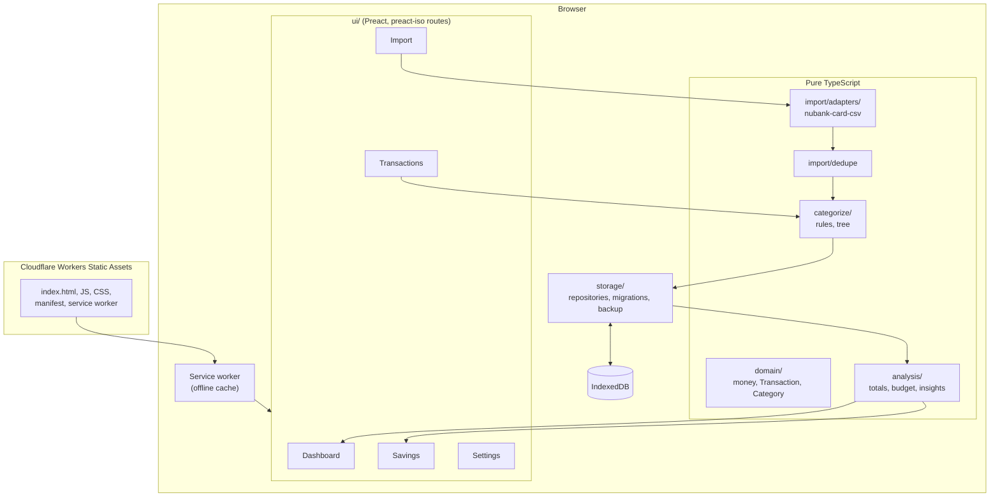
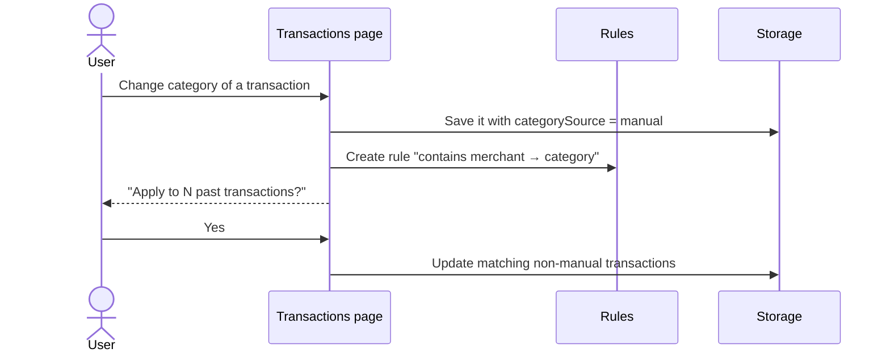
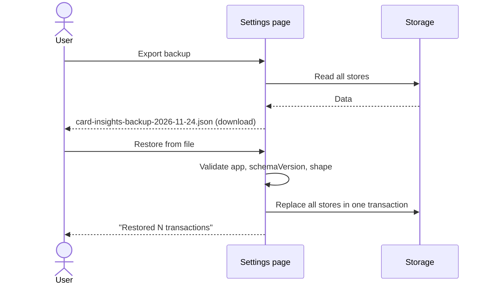

# Spec: card-insights v1

| | |
|---|---|
| **Status** | Draft |
| **Author** | Kaue Galon |
| **Date** | 2026-11-24 |
| **PRD** | [PRD v1](../prd/v1.md) |
| **Decisions** | [ADR 001](../adr/001-static-app-without-backend.md) to [ADR 007](../adr/007-editable-rules-for-categorization-without-ai.md) |

All examples in this document are **fictitious**.

## 1. Architecture



| Component | Role |
|---|---|
| **domain/** | Types (`Transaction`, `Category`, `Rule`, `Settings`) and money helpers (`parseBrlAmount`, `formatBrl`). No I/O. |
| **import/adapters/** | One `ImportAdapter` per file format. Turns text into `ParsedRow[]`. |
| **import/dedupe** | Compares parsed rows with what is stored; returns what to add and what to review. |
| **categorize/** | Default category tree and the rules engine. |
| **analysis/** | Totals, 50/30/20 and insights, as pure functions over transactions. |
| **storage/** | The only module that touches IndexedDB. Repositories per store, schema migrations, backup and restore. |
| **ui/** | Pages and components. Calls the pure modules and storage; holds no business rules. |
| **Service worker** | Caches the app shell for offline use (T20). Never caches or sends user data. |

## 2. Data model

Money is integer cents (`number`, always an integer); dates are ISO `YYYY-MM-DD` strings with no time zone ([ADR 005](../adr/005-money-in-integer-cents.md)).

### Transaction

| Field | Type | Notes |
|---|---|---|
| `id` | `string` | Random UUID, assigned on import. |
| `date` | `string` | ISO date from the file. |
| `rawTitle` | `string` | The title exactly as in the file. |
| `merchant` | `string` | Normalized: acquirer prefix and installment suffix removed, spacing collapsed. |
| `amountCents` | `number` | Positive for purchases and fees, negative for refunds and payments. |
| `kind` | `'purchase' \| 'refund' \| 'payment' \| 'fee'` | See §3.3. |
| `installment` | `{ n: number; total: number }?` | From `Parcela n/N`. |
| `categoryId` | `string?` | Subcategory id; absent means "Uncategorized". |
| `categorySource` | `'rule' \| 'manual'?` | A manual choice is never overwritten by rules. |
| `statementId` | `string` | Closing date of the statement, `YYYY-MM-DD`. |
| `fingerprint` | `string` | See §4. |
| `importId` | `string` | The import that added it. |
| `status` | `'ok' \| 'review'` | `review` until the user resolves a possible duplicate. |
| `updatedAt` | `string` | ISO timestamp, set by the repository on every write, strictly increasing per device ([ADR 008](../adr/008-data-durability-local-first-sync-ready.md), [ADR 009](../adr/009-sync-clock-and-record-identity.md)). |
| `updatedBy` | `string` | `deviceId` of the device that wrote it; breaks `updatedAt` ties in last-write-wins (ADR 009). |
| `deletedAt` | `string?` | Tombstone: a delete sets it instead of removing the record; queries skip it. |

### Other stores

| Store | Key | Content |
|---|---|---|
| `imports` | `id` | `{ id, adapterId, fileName, statementId, importedAt, summary: { added, existing, review } }`. Never the file content. |
| `categories` | `id` | `{ id, name, parentId?, budgetGroup?: 'needs' \| 'wants' \| 'savings' }`. Two levels. |
| `rules` | `id` | `{ id, match: 'contains' \| 'regex', pattern, categoryId, priority, origin: 'default' \| 'user' }`. |
| `settings` | `key` | `monthlyIncomeCents`, `statementClosingDay`, `demo`, `schemaVersion`, `deviceId` (random UUID, created once), `lastBackupAt?`, `backupFileHandle?` (File System Access handle, Chromium desktop), `lastSyncAt?` (unused until Phase 6), `lastStampAt` (last `updatedAt` stamped, ADR 009). |
| `dismissed` | `id` | `{ id, fingerprint, dismissedAt }`, one record per occurrence the user deleted, so re-import doesn't bring it back (§4). Indexed by `fingerprint`, which is never a key ([ADR 009](../adr/009-sync-clock-and-record-identity.md)). |

Every record in `imports`, `categories`, `rules` and `dismissed` also has `updatedAt`, `updatedBy` and `deletedAt?`, like `Transaction`, so a later sync (Phase 6) needs no schema change ([ADR 008](../adr/008-data-durability-local-first-sync-ready.md)).

## 3. Import

### 3.1 Adapter interface

```ts
interface ImportAdapter {
  id: string;                                   // 'nubank-card-csv'
  detect(file: { name: string; text: string }): boolean;
  parse(text: string, meta: { fileName: string; statementClosingDay?: number }): ParsedRow[];
}

interface ParsedRow {
  date: string;
  rawTitle: string;
  merchant: string;
  amountCents: number;
  kind: TransactionKind;
  installment?: { n: number; total: number };
  statementId: string;
}
```

The Import page runs `detect` on every registered adapter and uses the first that matches. No match is a user-facing error: "Format not recognized".

### 3.2 Nubank card CSV

Header, exactly: `date,title,amount`. Amounts are pt-BR, quoted, with `.` for thousands and `,` for decimals; a negative amount has a space after the sign.

```csv
date,title,amount
2026-10-21,Padaria Exemplo,"18,50"
2026-10-14,Mlp*Loja Exemplo - Parcela 2/6,"149,90"
2026-10-06,Pagamento recebido,"- 1.234,56"
2026-10-03,IOF de compra internacional,"3,12"
```

| Rule | Example → result |
|---|---|
| Amount | `"1.234,56"` → `123456`; `"- 1.234,56"` → `-123456`; `"60,00"` → `6000`; `"12,3"` → error |
| Installment | `Loja Exemplo - Parcela 2/6` → merchant `Loja Exemplo`, `{ n: 2, total: 6 }` |
| Prefixes | `Mlp*`, `Wl *`, `Dl*`, `Htm*`, `Pg *` and `<x> I*Vmt*Cielo`-style acquirer markers are stripped |
| Statement id | `Nubank_2026-11-11.csv` → `2026-11-11`. Any other name → the first closing date on or after the latest `date` in the file, using `settings.statementClosingDay` (passed in `meta`); without a closing day, the latest `date` itself. The statement id is for grouping in the UI only: dedupe never depends on it (§4) |

### 3.3 Kind

| Condition | Kind |
|---|---|
| Title is `Pagamento recebido` | `payment` (internal transfer: excluded from all spending totals) |
| Title starts with `IOF` or names interest (`Juros`) | `fee` |
| Negative amount, not a payment | `refund` |
| Anything else | `purchase` |

## 4. Dedupe

```
fingerprint = date | normalizedMerchant | amountCents | installment.n/total (or "-")
```

The file has no time and no row id, so two identical purchases on the same day are indistinguishable except by count ([ADR 006](../adr/006-dedupe-by-fingerprint-and-occurrence-count.md)).

1. Group incoming rows, and stored transactions whose `date` falls within the file's date range, by fingerprint. The scope is the date range, not the `statementId`: a partial export without the closing date in its name must still match the closed statement imported later.
2. For each fingerprint: `toAdd = max(0, countInFile − countStored − countDismissed)`. File has 3, store has 2 → add 1. `countDismissed` is the number of live `dismissed` records with that fingerprint: each row the user deleted (T15) is one, so it isn't added back.
3. An incoming row whose fingerprint is new but whose `date + amountCents` matches a stored transaction (same date range) with a different merchant is added with `status: 'review'` (likely the bank renamed it).
4. Return the rows to add (each with its `fingerprint` and `status`) and `ImportSummary { added, existing, review }`: disjoint counts that add up to the file's rows (`added` are new `ok` rows, `review` new `review` rows, `existing` rows skipped as stored or dismissed).

`normalizedMerchant` in the fingerprint is the row's `merchant` lowercased, without accents and with spacing collapsed.

## 5. Categorization

Rules run in ascending `priority`; the first match wins. `contains` is case- and accent-insensitive over the normalized merchant; `regex` is a JavaScript regex with the `i` flag. Transactions with `categorySource: 'manual'` are skipped.

Default tree (names shown in pt-BR in the UI):

| Category | Subcategories |
|---|---|
| Transport | Fuel, Ride apps |
| Food | Groceries, Produce, Bakery, Delivery, Restaurant |
| Health | Pharmacy |
| Education | Courses |
| Subscriptions | Software/Cloud, Games |
| Shopping | Electronics, Clothing and shoes |
| Home and services | Phone, Consulting |
| Fees | IOF, Interest |

**Learning (T09).** Changing a transaction's category creates a user rule `contains <merchant> → category` with a priority above all default rules, and offers to apply it to past transactions of that merchant.

## 6. Analysis

All functions take `Transaction[]` (plus settings) and return plain objects.

| Function | Output |
|---|---|
| `totalsByCategory(tx, period)` | Cents per category and subcategory; `payment` excluded; `refund` subtracts. |
| `compareWithPrevious(tx, statementId)` | Delta per category against the previous statement, in cents and %. |
| `topMerchants(tx, period, n)` | Merchants by total spent. |
| `futureInstallments(tx, fromStatement)` | Cents committed per future month: for a row at `n/total`, `total − n` more charges. |
| `budget503020(tx, month, settings)` | Share of income in needs, wants and savings vs 50/30/20, status `ok` / `warning` / `over`. |
| `insights(tx, settings)` | `{ id, title, why, amountCents }[]`, one per rule that fires (§PRD FR11). |

## 7. Storage

- IndexedDB through `idb`, database `card-insights`, one object store per table in §2, with indexes on `transactions.statementId`, `transactions.fingerprint` and `transactions.date`, and on `updatedAt` in every synced store (serves `changedSince`).
- `schemaVersion` increases with each change; `upgrade` runs the migrations in order. An open tab closes its connection when another tab opens a newer version; a tab whose upgrade waits on one that doesn't is told (`onBlocked`), so the UI can ask the user to close it.
- **Repositories:** UI and domain code never touch IndexedDB directly. Each store has a repository with `get`, `list`, `put`, `remove` and `changedSince(timestamp)`; `put` stamps `updatedAt` and `updatedBy`, `remove` stamps and sets `deletedAt`, `get` and `list` skip tombstones; `put` writes the record live, `remove` of an unknown key throws and `remove` of a tombstone does nothing. Each write is one IndexedDB transaction with one stamp: `updatedAt = max(now, lastStampAt + 1 ms)`, so `changedSince(lastSeen)` misses nothing ([ADR 009](../adr/009-sync-clock-and-record-identity.md)). A sync engine (Phase 6) plugs in behind the same interfaces.
- **Backup:** `{ app: 'card-insights', schemaVersion, exportedAt, data: { transactions, imports, rules, categories, settings, dismissed } }`, tombstones included as a downloaded JSON file. **Restore** validates the shape and version, then replaces everything in one transaction. A restored backup exported again is identical.
- **Delete all:** clears every store.
- The app calls `navigator.storage.persist()` to ask the browser not to evict data, and Settings show whether it was granted; if not, a banner suggests installing the app and turning on backups.
- **Automatic backup** ([ADR 008](../adr/008-data-durability-local-first-sync-ready.md)): on Chrome and Edge desktop the user picks a backup file once and the app rewrites it after every import or data change (debounced). Elsewhere, after each import and whenever the last backup is older than 30 days, a banner offers a one-tap download.

## 8. Flows

### 8.1 Import

```mermaid
sequenceDiagram
    actor U as User
    participant P as Import page
    participant A as Adapter
    participant D as Dedupe
    participant R as Rules
    participant S as Storage

    U->>P: Drop file
    P->>A: detect() / parse()
    alt no adapter matches
        P-->>U: "Format not recognized"
    else
        A-->>P: ParsedRow[]
        P-->>U: Preview of the rows
        U->>P: Confirm
        P->>S: Load transactions of the statement
        P->>D: dedupe(rows, stored)
        D-->>P: toAdd, review, summary
        P->>R: categorize(toAdd, rules)
        P->>S: Save transactions + import record (one transaction)
        P-->>U: Summary; items to review
    end
```

### 8.2 Recategorize



### 8.3 Delete a transaction

The user deletes a transaction from the Transactions page (T15) after a confirmation. Storage tombstones it and adds a `dismissed` record `{ id, fingerprint, dismissedAt }` in the same IndexedDB transaction; an "Undo" toast reverses both (the `dismissed` record is tombstoned too). Totals recompute from the store.

### 8.4 Backup and restore



## 9. Testing

- **Unit (Vitest):** every pure module, one test per acceptance criterion in the [plan](../plan.md). Fixtures in `test/fixtures/` are fictitious and follow the real format.
- **Storage:** `fake-indexeddb`; migration and backup round-trip tests.
- **End to end (T21):** Playwright on the built app: import → categorize → dashboard → savings, with `@axe-core/playwright`.
